# Introdução ao TCP e UDP

Veja o que abordaremos neste arquivo.

- Para começar, os fundamentos da Camada 4. Já cobrimos bastante conteúdo sobre as Camadas 1, 2 e 3. Por exemplo, na Camada 1, abordamos os tipos de cabos mais comuns utilizados em redes. Na Camada 2, tratamos de tópicos como endereços MAC, switching (comutação) e Spanning Tree. Na Camada 3, abordamos assuntos como endereços IP e roteamento. Agora, acredito que seja um bom momento para falar sobre a Camada 4;
- Após uma visão geral básica da Camada 4, apresentarei o TCP, ou Transmission Control Protocol (Protocolo de Controle de Transmissão);
- Em seguida, apresentarei o UDP, ou User Datagram Protocol (Protocolo de Datagrama de Usuário). O UDP é muito mais simples que o TCP, sendo mais fácil de compreender após o estudo do TCP; e
- Depois, faremos uma comparação entre os dois.

## Fundamentos da Camada 4

Vamos analisar algumas funções básicas dos protocolos da Camada 4. Para começar, a Camada 4 proporciona uma transferência transparente de dados entre hosts finais. Para explicar brevemente o que isso significa, veja esta imagem.

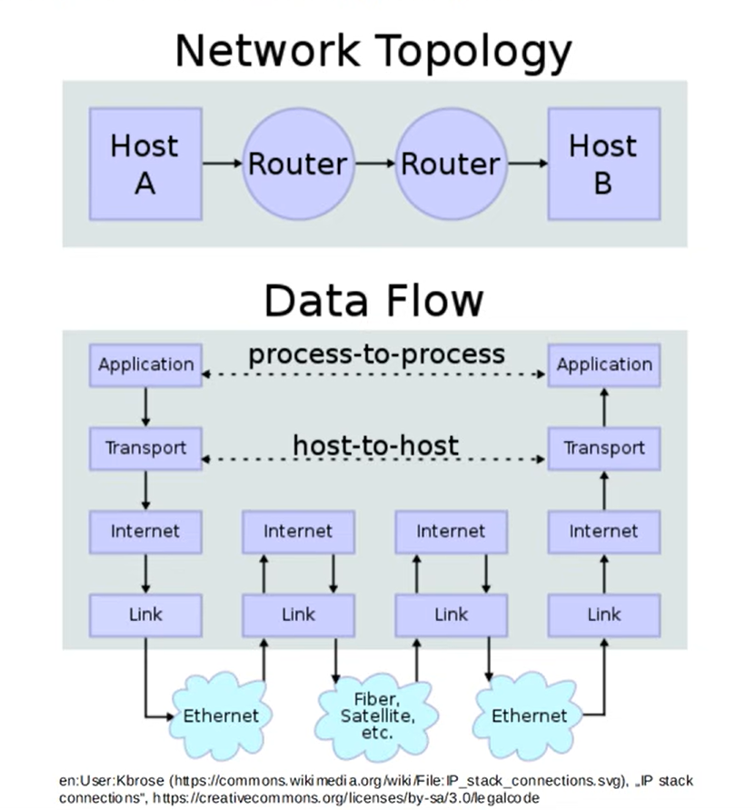

Esta imagem mostra a topologia de rede, com o Host A enviando dados para o Host B. O que a Camada de Transporte faz? Ela encapsula os dados com um cabeçalho da Camada 4 e, em seguida, utiliza os serviços das camadas inferiores — as Camadas 3, 2 e 1 — para entregar os dados, sem alterações, ao host de destino. Os próprios hosts não têm conhecimento dos detalhes da rede subjacente; a transferência de dados é "transparente" para eles.

Outra função dos protocolos da Camada 4 é oferecer — ou não — diversos serviços às aplicações. Você verá, em breve, que o TCP fornece esses serviços às aplicações, enquanto o UDP não o faz. Quais seriam alguns desses serviços? Um deles é a transferência confiável de dados.

Isso significa garantir que o host de destino tenha, de fato, recebido cada bit de dados que deveria receber. 

Outro serviço é a recuperação de erros. Caso ocorra um erro durante a transmissão, a Camada 4 pode assegurar que os dados sejam reenviados. Há também o sequenciamento de dados: mesmo que os dados cheguem ao destino fora de ordem, o host final consegue organizá-los na sequência correta. Mais um serviço é o controle de fluxo, que garante que o host de origem não envie tráfego em uma velocidade superior àquela que o host de destino consegue processar. Esses são serviços oferecidos pelo TCP, mas não pelo UDP. Explicarei isso com mais detalhes adiante; portanto, não se preocupe em memorizar tudo agora.

### Números de Porta, Multiplexação de Sessões

Bem, outra função da Camada 4 é fornecer endereçamento na própria Camada 4. Esses endereços são chamados de "números de porta". Vale notar que o termo "porta" também pode se referir às interfaces físicas onde conectamos cabos em dispositivos de rede; contudo, na Camada 4, o termo "porta" possui um significado completamente diferente. Esses números de porta desempenham algumas funções; uma delas é identificar o protocolo da Camada de Aplicação que está sendo utilizado.

Outra função é possibilitar o que chamamos de "multiplexação de sessões". Deixe-me explicar esses conceitos. 

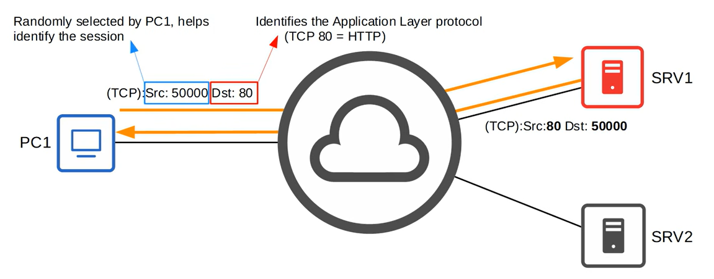

Aqui temos o PC1, que acessará recursos de dois servidores pela Internet: o SRV1 e o SRV2. Vamos ver como essas portas são usadas para identificar o serviço que o PC1 deseja acessar e para rastrear as sessões entre o PC1 e os servidores. Primeiramente, o que é uma sessão? É, basicamente, uma troca de dados entre dois ou mais dispositivos que se comunicam. No uso diário do seu PC, ele precisa ser capaz de lidar com múltiplas sessões de comunicação simultaneamente.

Talvez você tenha várias abas do navegador abertas, acessando diferentes serviços pela Internet. Provavelmente, há diversos serviços em execução no seu computador que precisam de acesso à Internet. No caso do PC1, digamos que ele esteja se comunicando com o SRV1. Na Camada 4, ele utiliza o protocolo TCP, com uma porta de origem 50000 e uma porta de destino 80. Para que servem essas portas? A porta de destino é fundamental: ela identifica o protocolo da Camada de Aplicação. Por exemplo, a porta TCP 80 é utilizada pelo protocolo HTTP, empregado para acessar sites.

Portanto, é possível que o SRV1 esteja hospedando uma página da web que o PC1 deseja acessar. E quanto à porta de origem? Ela é selecionada aleatoriamente pelo PC1 e, em conjunto com a porta de destino, ajuda a identificar a sessão. Por exemplo, após o SRV1 receber a mensagem do PC1, ele provavelmente enviará uma resposta. Na resposta do SRV1, observe que os números das portas de origem e de destino estão invertidos; a porta de origem é a 80 e a de destino é a 50000. 

Quando o PC1 recebe essa mensagem, os números das portas de origem e de destino indicam a ele que ela faz parte da mesma sessão de comunicação da mensagem que ele enviou anteriormente. 

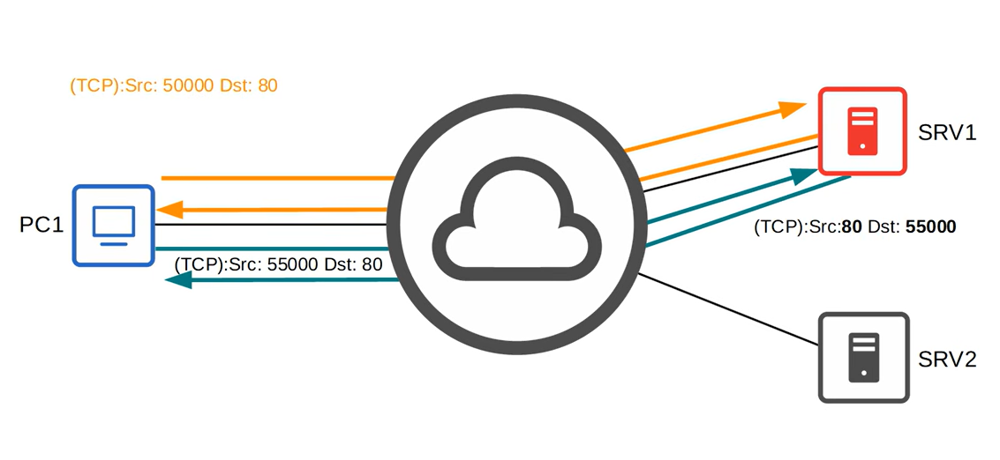

E se o PC1 abrir uma conexão separada com o SRV1? Ele pode estar usando HTTP na porta de destino 80 novamente, mas utilizando uma porta de origem diferente. A resposta do SRV1 usará essa porta de origem como porta de destino para sua resposta, de modo que o PC1 saiba que ela faz parte daquela sessão. Mas o PC1 deseja acessar algo no SRV2 ao mesmo tempo.

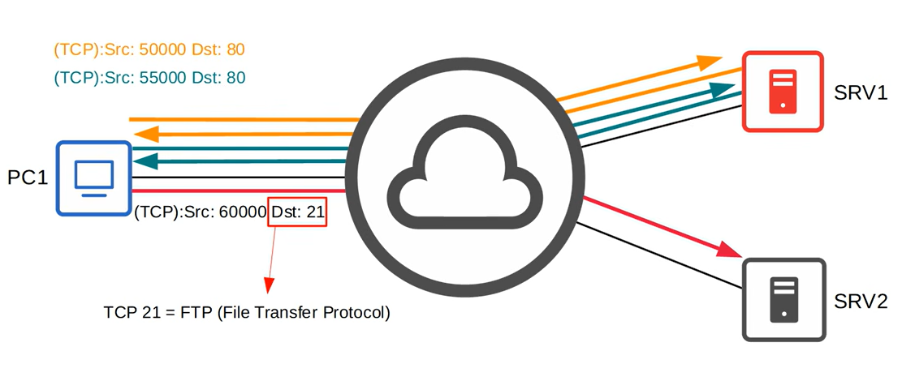

Ele utiliza o número de porta de destino TCP 21 e seleciona, aleatoriamente, a porta de origem 60000. A porta TCP 21 é usada para o FTP, o Protocolo de Transferência de Arquivos (File Transfer Protocol). Como o nome sugere, ele é utilizado para transferir arquivos. A resposta do SRV2 inverterá os números das portas, usando a porta de origem 21 e a porta de destino 60000. Isso indicará ao PC1 que essa comunicação faz parte da mesma sessão.

Bem, espero que isso tenha proporcionado uma compreensão básica de como as portas identificam o protocolo da Camada de Aplicação, como o HTTP (Hypertext Transfer Protocol — Protocolo de Transferência de Hipertexto), usado para acessar páginas da web, ou o FTP (File Transfer Protocol — Protocolo de Transferência de Arquivos), usado, como o próprio nome diz, para transferir arquivos.

Também mostrei como esses números são utilizados pelos hosts para gerenciar múltiplas sessões de comunicação simultaneamente.

Resumindo, o TCP garante:

1. Transferência confiável de dados
2. Recuperação de erros
3. Sequenciamento de dados
4. Controle de fluxo
5. Endereçamento
6. Multiplexação de sessões

Os números de porta utilizados pelos protocolos da Camada de Aplicação são registrados junto à IANA (Internet Assigned Numbers Authority — Autoridade para Atribuição de Números na Internet). Eles definiram as seguintes faixas:

- As portas conhecidas (well-known ports) compreendem o intervalo de 0 a 1023. Elas são usadas por protocolos importantes, como HTTP, FTP, etc., e são submetidas a uma regulamentação bastante rigorosa;
- As portas registradas (registered ports) situam-se na faixa de 1024 a 49151. É necessário realizar um registro para utilizar esses números de porta, embora o processo não seja tão rigoroso quanto o aplicado à faixa das portas conhecidas;
- Por fim, a faixa de 49152 a 65535 é utilizada para portas "efêmeras", também conhecidas como portas privadas ou dinâmicas. Os hosts utilizam essa faixa ao selecionar a porta de origem aleatória.

Observe que, no exemplo anterior, todos os números de porta de origem selecionados aleatoriamente pertenciam à faixa de portas efêmeras. Além disso, vale notar que os números de porta são um recurso presente nos dois principais protocolos da Camada 4: TCP e UDP. 

A seguir, explicarei cada um desses protocolos e você verá que as funcionalidades que mencionei anteriormente — transferência confiável de dados, recuperação de erros, sequenciamento de dados e controle de fluxo — são oferecidas pelo TCP, e não pelo UDP. Começarei explicando o TCP.

## Visão geral do TCP

Apresentarei uma visão geral de suas funcionalidades, analisaremos brevemente o cabeçalho TCP e, na sequência, aprofundarei a explicação sobre algumas de suas funções.

Para começar, o TCP é um protocolo orientado a conexão. O que isso significa? Bem, antes de efetivamente enviar dados para o host de destino, os dois hosts se comunicam para estabelecer uma conexão. Uma vez estabelecida a conexão, a troca de dados tem início. O host de origem não começa a enviar dados sem antes se comunicar com o host de destino e estabelecer essa conexão.

Além disso, o TCP proporciona uma comunicação confiável. Como ele faz isso? O host de destino deve confirmar o recebimento de cada segmento TCP. Lembre-se de que "segmento" é o nome dado à PDU da Camada 4 — assim como "pacote" na Camada 3 e "quadro" na Camada 2. Portanto, se o host de origem não receber uma confirmação referente a um segmento, ele é enviado novamente. 

Outro recurso oferecido pelo TCP é o sequenciamento. Na próxima imagem, você verá que existe um campo de sequência no cabeçalho TCP. Os números de sequência no cabeçalho TCP permitem que os hosts de destino organizem os segmentos na ordem correta, mesmo que eles cheguem fora de ordem.

Bem, uma última observação por enquanto: o TCP oferece controle de fluxo. Isso significa que o host de destino pode solicitar ao host de origem que aumente ou diminua a taxa de envio de dados, evitando que o destino fique sobrecarregado ao receber tráfego mais rapidamente do que consegue processá-lo. Certo, vamos dar uma olhada no cabeçalho TCP — agradecimentos à Wikipedia por esta imagem.

### Cabeçalho TCP

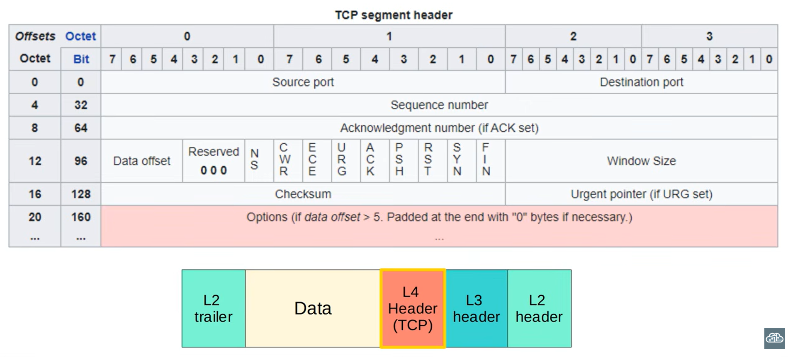

Como você pode ver, há diversos campos no cabeçalho TCP, utilizados para fornecer todos os serviços que mencionei anteriormente. Vou apenas destacar brevemente alguns campos importantes. Começando pelos campos de porta de origem e de destino.

Observe que cada campo tem 16 bits (2 bytes) de extensão. Isso significa que há um total de 65.536 números de porta disponíveis (ou seja, 2 elevado à 16ª potência). Os dois campos seguintes são o número de sequência (Sequence number) e o número de confirmação (acknowledgment number). Esses campos são usados ​​para garantir o sequenciamento e uma comunicação confiável; explicarei isso com mais detalhes adiante. 

O TCP possui uma série de bits de "flag", cada um com uma finalidade específica. Quero destacar três deles: ACK, SYN e FIN. Essas três flags são usadas para estabelecer e encerrar conexões. Explicarei esses processos com mais detalhes. O último campo que gostaria de destacar é o campo "Tamanho da Janela" (Window Size). Este campo é utilizado para controle de fluxo, ajustando a taxa na qual os dados são enviados. Bem, é isso sobre o cabeçalho TCP para esse arquivo. 

### Estabelecendo conexões TCP: *Three-way handshake* (aperto de mão de três vias)

Mencionei que o TCP é orientado a conexão, o que significa que é necessário que os hosts estabeleçam uma conexão antes de realmente enviar dados. O método que o TCP utiliza para estabelecer conexões é chamado de *TCP Three-way Handshake* (aperto de mão de três vias).

Recebe esse nome porque envolve o envio de três mensagens entre os dois *hosts*. Por exemplo, digamos que o PC1 queira acessar uma página da web no SRV1 usando HTTP. Primeiro, ele precisa estabelecer uma conexão TCP. Para isso, utiliza duas *flags* (sinalizadores) no cabeçalho TCP que acabei de mostrar: ACK, que significa confirmação (*acknowledgment*), e SYN, que significa sincronização (*synchronization*). 

Inicialmente, o PC1 envia um segmento TCP para o SRV1 com a *flag* SYN ativada — ou seja, esse *bit* está definido como 1. Essa é a primeira parte do *three-way handshake*. Em seguida, o SRV1 responde enviando um segmento TCP para o PC1 com as *flags* SYN e ACK ativadas. Portanto, ambos os *bits* estão definidos como 1. Essa é a segunda parte do *three-way handshake*. Por fim, o PC1 envia um segmento TCP com o *bit* ACK ativado. Agora, o *three-way handshake* está concluído e a conexão, estabelecida.

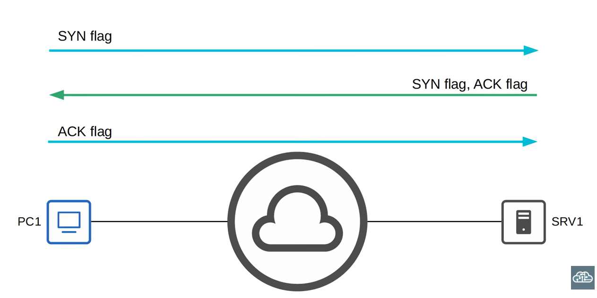

A troca real de dados pode, então, começar; as três primeiras mensagens, que compõem o *three-way handshake*, servem apenas para estabelecer a conexão. Lembre-se bem do *three-way handshake*: SYN, SYN-ACK e, depois, ACK.

### Encerrando conexões TCP: *Four-way handshake* (aperto de mão de quatro vias)

Agora, vamos falar sobre como o TCP encerra conexões. Esse processo, por vezes chamado de *TCP four-way handshake* (aperto de mão de quatro vias), é menos conhecido do que o *three-way handshake*. Quando o PC1 decide que não precisa mais da conexão com o SRV1, ele inicia este processo para encerrar a conexão. O processo utiliza duas flags no cabeçalho TCP: FIN e ACK.

Primeiro, o PC1 envia um segmento TCP para o SRV1 com a flag FIN ativada. O SRV1 responde com um ACK. Em seguida, o SRV1 envia seu próprio FIN. Por fim, o PC1 envia um ACK em resposta ao FIN do SRV1, e a conexão é encerrada.

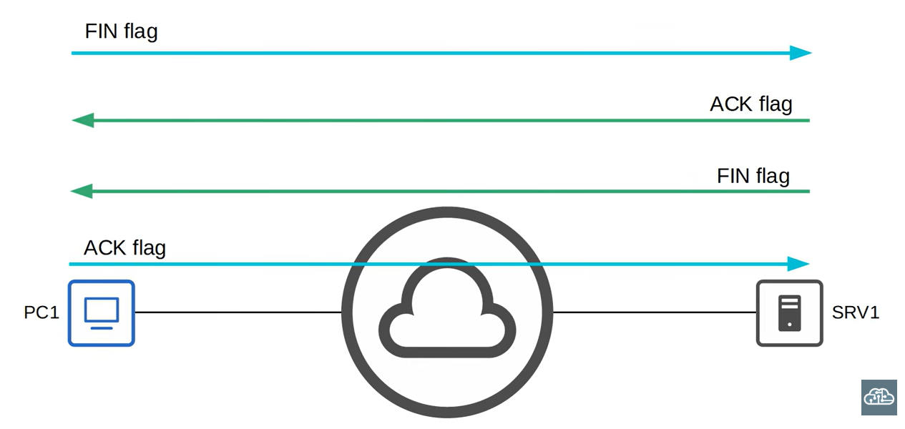

Então, você consegue entender o que significa "orientado a conexão"? Antes de efetivamente trocar dados, o PC1 e o SRV1 estabeleceram uma conexão. Bem, agora deixe-me demonstrar como o TCP utiliza os campos de sequência e confirmação (acknowledgment) do cabeçalho para garantir uma comunicação confiável e o sequenciamento. Vamos analisar uma troca entre dois computadores: PC1 e PC2.

### Sequenciamento/Confirmação (Acknowledgment) no TCP

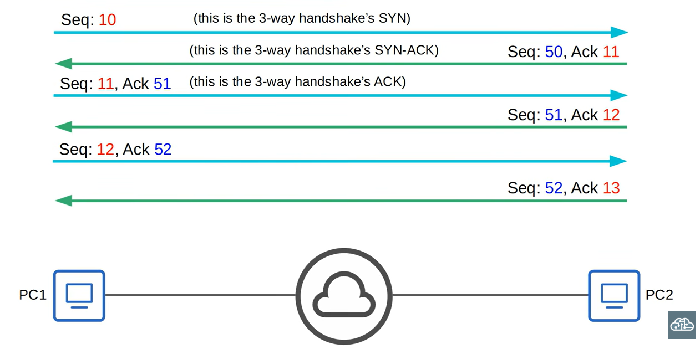

Quando o PC1 envia a mensagem SYN do *three-way handshake* (aperto de mão de três vias), ele define um número de sequência inicial aleatório; digamos que ele defina como 10. Então, quando o PC2 envia o SYN-ACK para o PC1, ele define seu próprio número de sequência inicial aleatório, por exemplo, 50. Além disso, ele confirma o recebimento do segmento do PC1 — que tinha o número de sequência 10 — definindo o campo de confirmação (acknowledgment) como 11. Por que 11?

Isso ocorre porque o TCP utiliza um mecanismo chamado "confirmação progressiva" (*forward acknowledgment*). Em vez de confirmar o número de sequência 10 usando o valor 10 no campo de confirmação, ele informa ao PC1 qual é o número de sequência do próximo segmento que espera receber. Dando continuidade a esse processo, o PC1 envia o ACK final do *three-way handshake* (estabelecimento de conexão em três etapas). 

O número de sequência é 11 e, utilizando o mecanismo de confirmação progressiva (*forward acknowledgment*), ele define o valor 51 no campo de confirmação (*acknowledgment field*). O PC2 responde com um número de sequência 51 e, novamente, utiliza a confirmação progressiva, definindo o valor 12 no campo de confirmação. A troca de informações prossegue, da seguinte forma.

Então, o que você deve guardar disso? Lembre-se de que os *hosts* definem um número de sequência inicial aleatório e que a confirmação progressiva é utilizada para indicar o número de sequência do próximo segmento que o *host* espera receber. 

Pois bem, mostrei como os campos de sequência e de confirmação no cabeçalho TCP são usados ​​para confirmar que o *host* recebeu cada segmento TCP que deveria receber. Esses números de sequência também permitem que os *hosts* identifiquem a ordem correta dos segmentos, mesmo que, por algum motivo, eles cheguem fora de ordem. 

E quanto ao pont de o segmento não for confirmado? O que acontece nesse caso? Ele é enviado novamente. Vou demonstrar brevemente. Para simplificar, apresentarei apenas um conjunto de números de sequência e de confirmação.

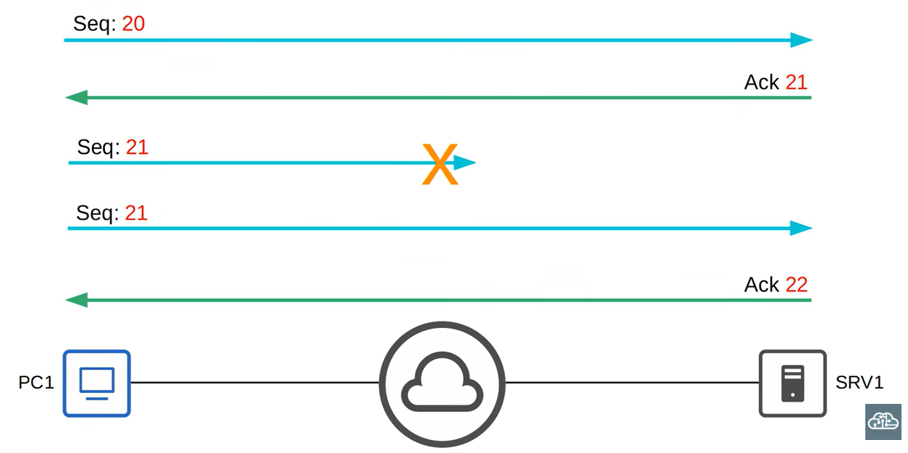

O PC1 envia ao SRV1 um segmento com número de sequência 20. Utilizando a confirmação progressiva, o SRV1 envia um ACK 21 ao PC1. Em seguida, o PC1 envia o número de sequência 21, mas, por algum motivo, ele não chega ao SRV1. Após aguardar um determinado período sem receber um ACK, o PC1 reenvia o segmento. Esse processo é chamado de retransmissão TCP. Desta vez, o SRV1 recebe o segmento e envia um ACK 22 para informar ao PC1 que o recebimento foi concluído. Muito bem, essa é uma visão geral bem resumida de como o TCP retransmite segmentos que não são confirmados. Por fim, vou explicar como o TCP realiza o controle de fluxo.

### Controle de Fluxo

Confirmar o recebimento de cada segmento, independentemente do seu tamanho, é ineficiente. No entanto, o campo "tamanho da janela" (window size) no cabeçalho TCP permite que mais dados sejam enviados antes que uma confirmação seja necessária. Veja um exemplo: um host pode enviar três segmentos, com números de sequência 20, 21 e 22, e, na sequência, uma confirmação (Ack) é enviada com o número de sequência 23. Além disso, uma "janela deslizante" (sliding window) é utilizada para ajustar dinamicamente o tamanho da janela.

O tamanho da janela é aumentado o máximo possível até que um segmento seja descartado; em seguida, o tamanho da janela é reduzido para um nível mais razoável e, depois, aumenta lentamente novamente. Bem, antes de prosseguir, deixe-me ressaltar um ponto.

Em todos esses exemplos, utilizei números de sequência bem simples. Em situações reais, os números de sequência tornam-se muito maiores e não aumentam de 1 em 1 a cada mensagem, especialmente quando o tamanho da janela deslizante se torna muito grande. Certo, essa foi uma visão geral bem breve das funções que o TCP oferece às aplicações.

Os detalhes que apresentei sobre números de sequência, confirmações de recebimento (acknowledgments), etc., serviram apenas para ajudar você a compreender os conceitos básicos. Agora que você viu parte do que o TCP oferece às comunicações, vamos analisar o UDP.

## Visão geral do UDP

O UDP é muito mais simples. O UDP não é orientado a conexão. Ele é um protocolo sem conexão (connectionless). Ao contrário do TCP, no UDP, o host de origem não estabelece uma conexão com o host de destino antes de enviar os dados. Os dados são simplesmente enviados. 

O UDP não oferece uma comunicação confiável. Quando o UDP é utilizado, não são enviadas confirmações de recebimento (acknowledgments) para os segmentos recebidos. Se um segmento for perdido, o UDP não possui nenhum mecanismo para retransmiti-lo. Os segmentos são enviados com base no princípio de "melhor esforço" (*best-effort*). Talvez você não esteja familiarizado com esse termo. Basicamente, ele significa que o UDP não oferece garantia de entrega, ao contrário do TCP. Ele envia os dados, faz o esforço, mas não oferece nenhuma garantia. 

O UDP não realiza o sequenciamento. Diferente do TCP, o UDP não possui um campo de sequência em seu cabeçalho. Se os segmentos chegarem fora de ordem, o UDP não dispõe de um mecanismo para reorganizá-los. Por fim, o UDP não oferece controle de fluxo. Ele não conta com um mecanismo, como o "tamanho da janela" (*window size*) do TCP, para controlar o fluxo de dados.

Vamos dar uma olhada no cabeçalho do UDP — agradecimentos, mais uma vez, à Wikipedia pela imagem.

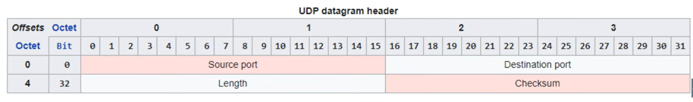

É isso: quatro campos. Números de porta de origem e de destino, um campo que indica o tamanho do segmento, e uma soma de verificação (*checksum*) para que o host receptor possa detectar erros. Na próxima imagem, vamos comparar o TCP e o UDP.

## Comparação entre TCP e UDP

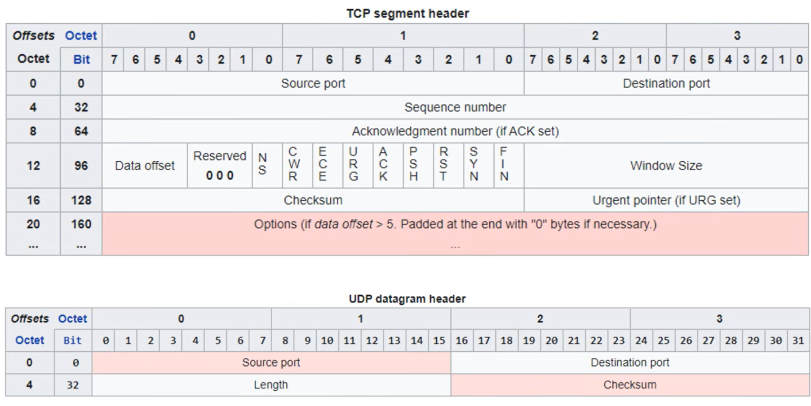

Para começar, aqui estão os dois cabeçalhos para comparação. Todos os campos adicionais presentes no TCP permitem que ele ofereça funcionalidades extras, como o sequenciamento e a recuperação de erros. Então, em quais situações o TCP seria utilizado, e em quais o UDP seria a escolha ideal?

O TCP oferece mais recursos que o UDP, mas isso acarreta um *overhead* (sobrecarga) adicional, devido ao seu cabeçalho maior. Além disso, as confirmações de recebimento (*acknowledgments*) e as retransmissões podem tornar a transferência de dados mais lenta. Para aplicações que exigem uma comunicação confiável — como, por exemplo, o download de um arquivo —, o TCP é a opção preferida. Você certamente não gostaria de baixar um arquivo PDF com uma página faltando; você quer ter certeza de que obteve o arquivo completo. 

Por outro lado, para aplicações que envolvem voz e vídeo em tempo real — como chamadas telefônicas via IP (VoIP), Zoom, Skype, etc. —, o protocolo UDP é o preferido. Essas aplicações são extremamente sensíveis a atrasos (latência); portanto, não é desejável que a sobrecarga (overhead) do TCP comprometa o desempenho. Vale ressaltar que existem aplicações que utilizam o UDP, mas implementam mecanismos de confiabilidade dentro da própria aplicação. O TFTP (Trivial File Transfer Protocol) é um exemplo disso. Pense, por exemplo, em uma chamada pelo Skype: se você estiver conversando com alguém pelo Skype e o áudio falhar por alguns segundos, basta pedir à outra pessoa que repita o que disse. Na prática, você está solicitando uma "retransmissão".

Por fim, há aplicações que utilizam tanto o TCP quanto o UDP, dependendo da situação. O DNS (Domain Name System) é um exemplo disso. 

Mas não se esqueça: tanto o TCP quanto o UDP oferecem endereçamento na Camada 4 por meio de números de porta. Esses números de porta identificam protocolos da Camada de Aplicação e permitem a multiplexação de sessões. Como ambos são protocolos da Camada 4, eles desempenham essas funções essenciais.

## Números de porta importantes

Para encerrar, apresentarei alguns números de porta bem conhecidos que você deve conhecer. Embora ainda não tenhamos estudado detalhadamente esses protocolos da Camada de Aplicação neste curso, recomendo que você reserve um tempo para memorizar esses números de porta agora. Aqui está a lista. 

- Para começar, o FTP, O File Transfer Protocol (Protocolo de Transferência de Arquivos) utiliza as portas TCP 20 e 21;
- O SSH (Secure Shell), comumente utilizado para se conectar à CLI (interface de linha de comando) de roteadores e switches, utiliza a porta TCP 22;
- O Telnet, que também pode ser usado para se conectar à CLI de dispositivos, utiliza a porta TCP 23;
- O SMTP (Simple Mail Transfer Protocol) é utilizado para o envio de e-mails e utiliza a porta TCP 25;
- O HTTP (Hypertext Transfer Protocol), comumente utilizado para acessar páginas da web, utiliza a porta TCP 80;
- O POP3 (Post Office Protocol 3), utilizado para recuperar e-mails, utiliza a porta TCP 110; e
- Finalmente, o HTTPS (Hypertext Transfer Protocol Secure) utiliza a porta TCP 443.

Muito bem, vamos listar alguns protocolos que utilizam UDP. 

- O DHCP (Dynamic Host Configuration Protocol), que permite que hosts definam automaticamente seu endereço IP e outras configurações, utiliza as portas UDP 67 e 68;
- O TFTP (Trivial File Transfer Protocol) utiliza a porta UDP 69;
- O SNMP (Simple Network Management Protocol) utiliza as portas UDP 161 e 162;
- O Syslog utiliza a porta UDP 514;
- Por fim, o único protocolo que você deve conhecer que utiliza tanto TCP quanto UDP é o DNS (Domain Name System). Ele geralmente utiliza UDP, mas, em algumas situações, utiliza TCP.
